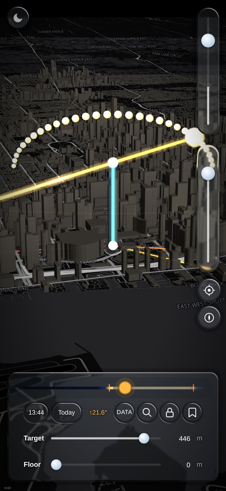

# Soluna: plan a photograph around the light

By [Blair Zasitko](https://blairz.ca)

**Open it: https://blairz.ca/soluna/** (made for a phone; add it to the home screen)

Choose where you will stand and what you want behind the sun or the moon. Soluna draws the
body's path over a 3D map of the city, shows where shadows fall, and searches forward in time
for the minute the light lines up with your landmark. Save a position and come back to see
whether today is the day.

Photographs planned with it: https://blairz.ca/apps/soluna/

## How it works

- Sun and moon positions are computed in the browser (`js/solar.js`); nothing is queried.
- Shadows are worked out from the real 3D buildings and the ground's elevation
  (`js/layers/shadow.js`), including when one building shades another.
- The controls are real refractive glass drawn by one WebGL shader over the finished map
  (`kit/`, from [glass-ui-kit](https://github.com/datumsOG/glass-ui-kit)).
- It installs as a home-screen app and works offline after the first load (`sw.js`).
- No framework and no build step: plain JavaScript modules on [MapLibre GL JS](https://maplibre.org/).
  Serve the folder with any static server.

`?perf=1` shows a live frame meter. `js/perf.js` lists the switches and what each costs.

## How it was made

I designed Soluna and directed its construction with AI coding agents (Claude Code): I wrote the
specification, made the design decisions and tested each build on my own phone. The comments
that quote me by date are the design decisions, kept next to the code they changed.

## Credits

Map: [OpenFreeMap](https://openfreemap.org/), © [OpenStreetMap](https://www.openstreetmap.org/copyright) contributors.
The code is MIT-licensed (see `LICENSE`).
